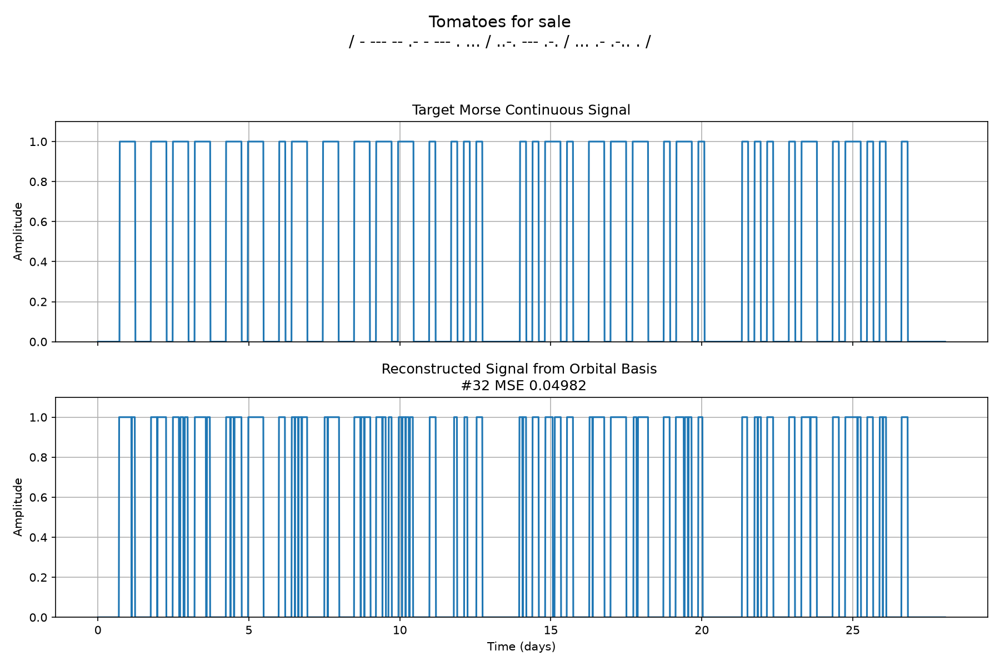

# Luna Tomato Advertising (ESA SpOC 4, Challenge 3)

Projekt universitar. Problemi: të zgjedhim anije kozmike në orbita hënore dhe fazat e tyre, në mënyrë që pulset e okultimit të riprodhojnë sinjalin Morse "Tomatoes for sale" me MSE < 0.05, duke përdorur sa më pak anije të jetë e mundur. Rezultati (pikët) është numri i anijeve: sa më i vogël, aq më mirë.

## Rezultati më i mirë

**32 anije, MSE = 0.0498** (kontrolluar me funksionin zyrtar `udp.fitness`).



## Algoritmet e provuara

- **Greedy**: shton anijen që ul më shumë gabimin, një nga një.
- **Random search**: zgjedh anije rastësisht.
- **Hill climbing**: ndryshime të vogla, pranon vetëm përmirësime.
- **Simulated annealing (SA)**: si hill climbing, por pranon edhe ndryshime më të këqija herë pas here për të mos u ngecur.
- **Pruning** (`prune.py`): heq anijet e tepërta nga një zgjidhje e gatshme.

## Rezultatet

Krahasimi i algoritmeve (mesatare për 3 seed-e):

| Algoritmi | Anije | Vërejtje |
|---|---|---|
| Greedy | 61.7 | MSE mbi 0.05, e pavlefshme |
| Random search | 40 | MSE rreth 0.40, e pavlefshme |
| Hill climbing | 47.7 | e vlefshme |
| SA | 40.7 | e vlefshme |

Efekti i kohës (seed 1): 15 s 44, 30 s 39, 1 min 38, 2 min 39, 5 min 37 anije.

Ekzekutime të gjata: 30 min 34-35 anije; 90 min (12 seed-e) 33-36, mesatare 34.1; 120 min 33-34. Shtatë seed-e të ndryshme arritën 33. Pruning nuk gjeti asnjë anije të tepërt në 18 zgjidhje. Me prag më të lirë MSE (0.0499), një seed (131, 120 min) arriti **32 anije**, me MSE 0.0498, shumë afër pragut 0.05.

## Si funksionon zgjidhja

Sinjali ndahet në 2710 kuti kohe. Çdo anije prodhon pulse në disa kuti, varësisht nga orbita dhe faza. Gabimi MSE është pjesa e kutive që dalin gabim (një sinjal bosh ka 0.4649, pragu është 0.05, pra rreth 135 kuti gabim).

Fillojmë me greedy, pastaj SA përmirëson zgjidhjen. Energjia = numri i anijeve + penalizim nëse MSE kalon një prag sigurie. Lëvizjet: ndrysho fazën (45%), zhvendos anijen në orbitë tjetër (30%), hiq anije (15%), shto anije (10%).

**Seed** është numri fillestar i gjeneratorit të rastit. Seed-e të ndryshme japin zgjidhje të ndryshme, prandaj provojmë shumë.

## Kufizimet

- 32 anije është më e mira që gjetëm, me margjinë shumë të vogël nga pragu 0.05 (MSE 0.0498). Vetëm një seed nga 9 me pragun e ri e arriti, pra rezultati varet shumë nga fati i seed-it.
- Në tabelën Optimise rezultatet më të mira janë 28-29 anije, pra metoda jonë mund të përmirësohet (p.sh. algoritme gjenetike ose kërkim më i mirë i fazave).

## Skedarët

- `lta_udp.py`: problemi zyrtar nga ESA (i modifikuar, shih më poshtë)
- `01_explore.py`: eksploron problemin (mesazhi, Morse, orbitat)
- `02_nje_anije.py`: provë me një anije të vetme
- `solve_lta.py`: algoritmi kryesor (greedy + SA)
- `run_tests.py`: testet me seed-e dhe kohë të ndryshme, ruan `results/results.csv`
- `compare_algos.py`: krahason algoritmet, ruan `results/algoritmet.csv`
- `long_run.py`: ekzekutime të gjata me seed-e të ndryshme
- `prune.py`: heq anijet e tepërta
- `plot_best.py`: vizaton zgjidhjen më të mirë
- `results/`: rezultatet dhe zgjidhjet (`.npy`)

## Si ekzekutohet

```
python 01_explore.py
python solve_lta.py 5          # 5 minuta
python run_tests.py 1
python compare_algos.py 1
python long_run.py 30 1 2 3    # 30 min, seed-et 1, 2, 3
python plot_best.py
```

Nevojiten vetëm `numpy` dhe `matplotlib`.

## Kredite

Problemi dhe `lta_udp.py` vijnë nga ESA SpOC 4: https://github.com/esa/SpOC4

Ndryshimet e mia në `lta_udp.py`: `heyoka` është bërë opsional (nuk instalohej në Python 3.15) dhe skedarët e të dhënave gjenden automatikisht në folder.